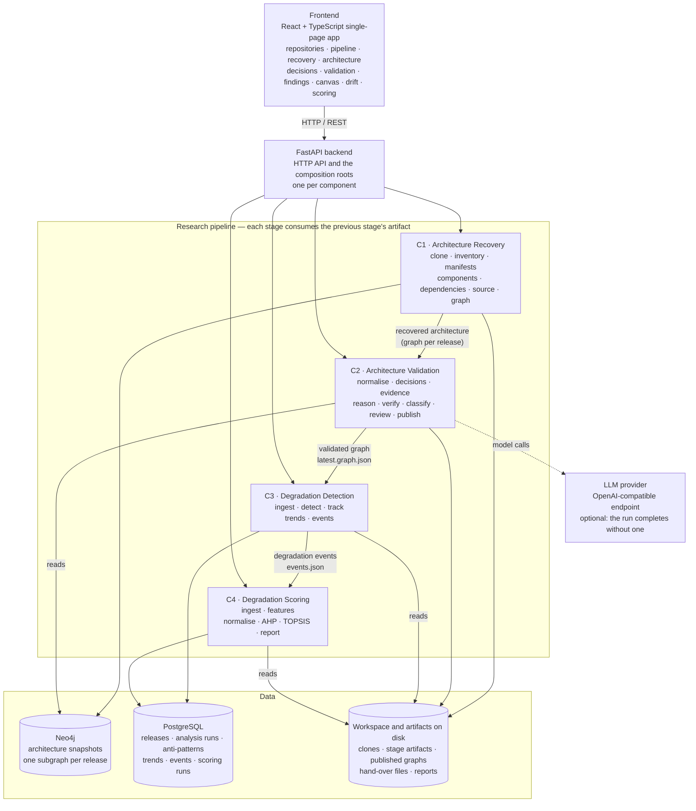

# Detection of Architectural Degradation during the Maintenance Phase

A research system that recovers the architecture a software system **actually has**, judges it against the architecture that was **intended**, and then decides — across releases, with statistical evidence — where the system is degrading and how severe each case is.

**Release:** `v0.1.0` · **Backend:** Python 3.13 / FastAPI · **Frontend:** React + TypeScript

---

## 1. What we are solving

Software systems spend most of their life in maintenance, and most of the cost of that phase is architectural rather than functional. Code keeps working while the structure around it quietly decays: a service starts depending on something it never should have, a module grows until everything routes through it, a cycle forms between two components that used to be independent. None of these breaks a test. They surface years later as the reason a small change takes a month.

The difficulty is that nobody has an up-to-date picture of the architecture to compare against. The diagram in the wiki describes the system as it was designed; the code describes the system as it is; the two have been drifting apart since the first sprint. Static analysis tools report rule violations without any idea what the team intended, and they report them per snapshot, so every release produces the same list and nobody can tell what is actually *getting worse*.

This project asks one question:

> **Given a system's released history, can we recover its architecture from the repository itself, judge it against the intent that was recorded, and then detect — with evidence, not opinion — which architectural problems are worsening over time and which matter most?**

The answer is a four-stage pipeline. Each stage produces an artifact the next one consumes, and every claim it makes is traceable to the file or line it was read from.

| Stage | Question it answers | Its output |
| ----- | ------------------- | ---------- |
| **Architecture Recovery** | What is this system actually made of? | A version-scoped architecture graph per release |
| **Architecture Validation** | Does that match what was intended? | The same graph, each relationship carrying a verdict |
| **Degradation Detection** | What is getting worse across releases? | Degradation events with their statistical support |
| **Degradation Scoring** | Which of them matters most? | A ranked, explained severity report |

Two deliberate positions run through the whole design. First, **evidence ceilings**: a dependency inferred from directory layout, or an intent read out of a commit message, can raise a question but can never be reported as a violation — enforced in code, so it holds even when a model is wrong. Second, **an unperformed check never looks like a passed check**: a criterion that could not run is reported as inactive with its reason, not silently weighted to zero.

---

## 2. High-level architecture



**How to read it.** The frontend is a single-page app that talks only to the HTTP API — it never reaches a database or the filesystem. The API is a thin composition root per component: it decides which adapter is real, and the research logic underneath knows nothing about HTTP. Components never import each other; they meet on artifacts, so each one can be run, tested and replaced on its own.

**Why two databases.** They hold different shapes of data. Neo4j holds the architecture itself, where traversal across releases is the query; PostgreSQL holds the run records, releases and audit rows, where integrity and tabular queries are what matter. Files hold the artifacts a run produces and the published documents the next stage reads, which keeps every stage debuggable without a database client.

### What each component owns

| | Component | Reads | Produces | Needs |
| - | --------- | ----- | -------- | ----- |
| **C1** | `architecture_recovery` | a git repository at one release | one architecture snapshot per release, plus six stage artifacts | Neo4j, disk, git |
| **C2** | `architecture_validation` | C1's snapshot, plus repository files and the decision history | `latest.graph.json` — the graph with a verdict on every relationship | Neo4j (read), disk, *optional* model |
| **C3** | `degradation_detection` | every validated graph of one system | degradation events with trends and corrected significance | PostgreSQL, disk |
| **C4** | `degradation_scoring` | C3's events plus the release package | a ranked severity report, as files and rows | PostgreSQL, disk, *optional* git history |

Per-component architecture documents — connection maps, stages, persistence, invariants — are in [`docs/component-architecture/`](./docs/component-architecture/).

---

## 3. Repository layout

```
architecture-degradation-detector/
├── backend/
│   ├── app/
│   │   ├── api/                    # HTTP layer; one module per component, each a composition root
│   │   ├── components/             # the four research components
│   │   │   ├── architecture_recovery/
│   │   │   ├── architecture_validation/
│   │   │   ├── degradation_detection/
│   │   │   └── degradation_scoring/
│   │   ├── core/                   # settings and logging
│   │   ├── domain/                 # models that cross a component boundary
│   │   ├── infrastructure/         # adapters: git, Neo4j, PostgreSQL, AI, file stores
│   │   └── shared/                 # small dependency-free helpers
│   ├── alembic/versions/           # database migrations
│   ├── configs/                    # C3 detection config and catalog, C4 weighting
│   ├── scripts/                    # CLIs for evaluation and offline runs
│   ├── tests/
│   ├── config.ini                  # committed, non-sensitive tuning
│   ├── .env.example                # copy to .env; secrets and machine-specific values
│   └── docker-compose.yml          # PostgreSQL and Neo4j
├── frontend/
│   └── src/
│       ├── features/               # one folder per screen
│       ├── components/             # shared UI, graph renderer
│       ├── lib/api/                # typed client, one module per component
│       └── workspace/              # repository selection, pipeline orchestration
├── docs/
│   ├── component-architecture/     # the four documents above
│   ├── adr/                        # architecture decision records
│   └── ai/                         # model access notes
├── Makefile                        # up · backend · frontend · dev · install · test · lint
├── ARCHITECTURE.md                 # intended architecture and boundaries
└── README.md
```

---

## 4. What this release contains

`v0.1.0` is the first end-to-end release: all four components run from the UI, on real repositories, and hand off to each other.

| | Component | State in v0.1.0 |
| - | --------- | --------------- |
| **C1** | Recovery | Complete pipeline: clone, inventory, manifest analysis, component discovery, dependency resolution, source analysis, graph construction. Five manifest formats (Compose, Kubernetes, Dockerfile, OpenAPI, Protobuf). |
| **C2** | Validation | All eight stages implemented: normalisation, decision knowledge (three sources), evidence retrieval, reasoning, independent verification, classification, architect review, publishing. Runs without a model by falling back to a deterministic table, and says so on every verdict. |
| **C3** | Detection | Trend-only baseline: per-release anti-pattern detection, cross-release tracking, Mann-Kendall/Sen's slope with Benjamini–Hochberg correction, event export. Context, retrieval and LLM stages are configured but deliberately off. |
| **C4** | Scoring | Four of its stages are wired: ingestion, feature extraction, AHP + TOPSIS ranking, reporting. The LLM-written explanation stage is not in the running path. |

**Known limits, stated rather than hidden:** C3 reports trends only once a series has 8 non-null points, so a two-release repository gets per-release anti-patterns and no events. C4's hotspot criterion needs a full history clone and a manual element-to-path mapping; the decision-violation criterion is reachable only from the C4 CLI, not from the UI. These are research-scope decisions documented per component, not defects.

---

## 5. Prerequisites

| Tool | Version | Why |
| ---- | ------- | --- |
| Python | 3.13 | the backend requires `>=3.13` |
| [uv](https://docs.astral.sh/uv/) | current | installs and runs the backend |
| Node.js | ≥ 22.22 | the frontend build |
| Docker + Compose v2 | current | PostgreSQL and Neo4j |
| git | current | the backend clones the repositories it analyses |
| GNU make | optional | task shortcuts; every target has a plain command below |

---

## 6. Setup

```bash
git clone https://github.com/Imadh-Ifham/architecture-degradation-detector.git
cd architecture-degradation-detector
```

### 6.1 Databases

```bash
docker compose -f backend/docker-compose.yml up -d     # or: make up
```

This starts PostgreSQL 17 on host port **5434** and Neo4j 2025.08 on **7474** (browser) and **7687** (bolt). Port 5434 rather than 5432 is deliberate: a native PostgreSQL service commonly owns 5432 and would shadow the container.

### 6.2 Backend

```bash
cd backend
cp .env.example .env          # then fill in the values below
uv sync                       # creates .venv and installs dependencies
uv run alembic upgrade head   # creates the tables
```

`.env` needs at minimum:

```dotenv
POSTGRES_HOST=localhost
POSTGRES_PORT=5434
POSTGRES_DB=architecture_degradation
POSTGRES_USER=architecture
POSTGRES_PASSWORD=<the password from docker-compose.yml>

NEO4J_URI=bolt://localhost:7687
NEO4J_USER=neo4j
NEO4J_PASSWORD=<the password from docker-compose.yml>
```

The credentials shipped in `docker-compose.yml` are development defaults; keep `.env` in step with them if you change them.

### 6.3 Frontend

```bash
cd frontend
npm install
```

### 6.4 Optional: model access

Validation reaches a model through any OpenAI-compatible endpoint, so the provider is a URL and a key rather than a vendor SDK. It runs without one — the two model stages report themselves unavailable and every governed fact gets a verdict from the deterministic table, labelled as such — but a key is what makes the verification stage real.

```dotenv
AI_API_KEY=<your key>
# AI_BASE_URL=https://api.groq.com/openai/v1
# AI_REASONER_MODEL=...
# AI_VERIFIER_MODEL=...
```

---

## 7. Configuration

Three layers, lowest precedence first, so nothing committed has to be edited per machine:

| Layer | File | Committed | Holds |
| ----- | ---- | --------- | ----- |
| Defaults | `backend/app/core/config.py` | yes | every setting's default |
| Tuning | `backend/config.ini` | yes | scan limits, clone timeout, validation input source, all C4 scoring parameters |
| Environment | `backend/.env` | **no** | database hosts and credentials, workspace paths, model key |

Anything in `.env` overrides `config.ini`, which overrides the defaults. A container or CI job overrides through environment variables alone.

Settings you are likely to touch:

| Setting | Where | Default | Effect |
| ------- | ----- | ------- | ------ |
| `REPOSITORIES_ROOT` | `.env` | `<system temp>/add-repositories` | where clones and their artifacts live — one directory per analysed release |
| `SCORING_OUTPUTS_ROOT` | `.env` | `backend/artifacts/scoring` | where C4 writes its reports |
| `[git] clone_timeout_seconds` | `config.ini` | `300` | abandons a stalled clone |
| `[inventory] max_files`, `max_file_size_bytes` | `config.ini` | `20000`, `5 MB` | bounds the working-tree walk |
| `[validation] architecture_source` | `config.ini` | `graph` | which reader C2 uses: recovery's live graph, a recorded snapshot, or an inventory recording. Never a silent fallback — whichever answered is stamped on the run |
| `configs/default.yaml` | committed | — | every C3 threshold and statistical parameter; unknown keys are rejected at start-up |
| `configs/catalog.yaml` | committed | — | which anti-pattern detectors run per architecture style |
| `[scoring] scoring_*` | `config.ini` | — | C4 weights, normalisation, TOPSIS mode; each run's manifest records what it used |

Detection and scoring fold their configuration into a hash stored on every run, so a result can always be traced to the exact settings that produced it. Freeze those files before an evaluation run.

---

## 8. Running

```bash
make dev        # backend on :8000 with autoreload, frontend on :5173
```

or, in two terminals:

```bash
cd backend  && uv run uvicorn app.main:app --reload     # http://127.0.0.1:8000
cd frontend && npm run dev                              # http://localhost:5173
```

The Vite dev server proxies `/api/*` to the backend, so only the frontend URL needs opening.

| URL | What |
| --- | ---- |
| http://localhost:5173 | the application |
| http://127.0.0.1:8000/docs | the API reference, generated from the routes |
| http://localhost:7474 | Neo4j Browser, to inspect recovered graph history |

### A first run

1. **Repositories** — add a snapshot: repository URL, branch, release tag. This writes the configuration down and clones nothing.
2. **Pipeline** — add one or more snapshots, then run recovery. Snapshots are cloned and analysed **sequentially**, one at a time; a snapshot already cloned or already recovered is skipped rather than redone.
3. **Decisions** — choose what each release is judged against: decision records in the repository, records in a repository you name, or the repository's own records plus rules reconstructed from its configuration. Per release, because sources appear partway through a history.
4. **Validation** — run it for each release. The screen shows the three judges side by side, the stage record, and the model calls themselves.
5. **Detection** — once every release in scope is judged, detect over the whole history. The Drift screen shows each release, its anti-patterns, and which measures are worsening.
6. **Scoring** — rank the events of that detection run and read the severity report, with the arithmetic behind every score.

Start with a repository that has several tagged releases: detection compares releases, so one release cannot show a trend.

### Tests

```bash
make test       # backend: uv run pytest  (~3 minutes, 3200+ tests)
make lint       # frontend: oxlint
cd frontend && npm run build    # type-check and production build
```

---

## 9. Documentation

| Document | What it covers |
| -------- | -------------- |
| [`ARCHITECTURE.md`](./ARCHITECTURE.md) | intended architecture: boundaries, layering, database roles, AI abstraction |
| [`INSTRUCTIONS.md`](./INSTRUCTIONS.md) | code layout and file-placement rules |
| [`docs/component-architecture/architecture-recovery.md`](./docs/component-architecture/architecture-recovery.md) | C1 as built: connection map, seven stages, workspace and graph layout |
| [`docs/component-architecture/architecture-validation.md`](./docs/component-architecture/architecture-validation.md) | C2 as built: eight stages, ports, published document, persistence |
| [`docs/component-architecture/degradation-detection.md`](./docs/component-architecture/degradation-detection.md) | C3 as built: five stages, trend method, tables and hand-over files |
| [`docs/component-architecture/degradation-scoring.md`](./docs/component-architecture/degradation-scoring.md) | C4 as built: four wired stages, criteria, ranking, report |
| [`docs/adr/`](./docs/adr/) | architecture decision records |
| [`docs/ai/model-access.md`](./docs/ai/model-access.md) | how components reach a model |
| [`backend/README.md`](./backend/README.md) | endpoint reference and per-stage backend detail |

---

## 10. Research context

The system is built so that its claims can be checked rather than believed. Every recovered relationship carries the evidence that produced it and whether a source file corroborated it; every verdict carries the citation it rests on and whether a second model objected; every trend publishes its test statistic, corrected q-value and the points it was computed from; every score publishes the normalised value, weight and contribution behind it. Where a stage could not run, it says so and says why.

That is what makes the negative results usable too: a criterion that is inactive, a series too short to test, a fact no decision speaks to — each is reported as a finding in its own right rather than disappearing into an average.

---

## License

See [LICENSE](./LICENSE).
