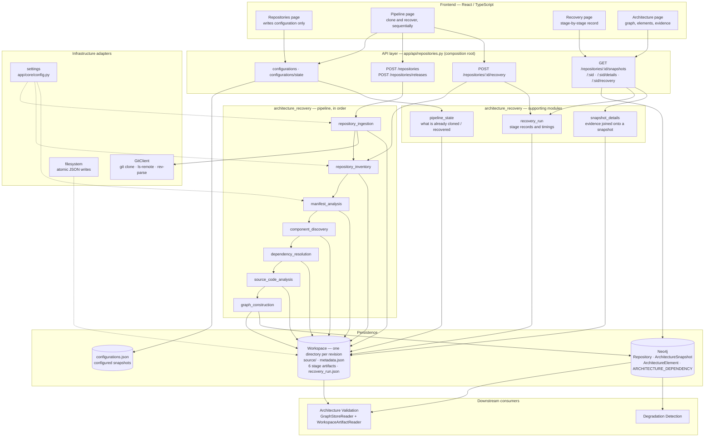

# Architecture Recovery — current architecture

**Component:** `backend/app/components/architecture_recovery/`
**Status:** implemented and running. This document records **what exists today**, not what is planned.
**Reads:** a git repository (url + branch + release tag), the working tree it produces, and the configuration in `config.ini` / `.env`.
**Produces:** one version-scoped architecture snapshot per analysed revision, published to Neo4j, with its stage artifacts and a run record on disk.

> Companion documents for the other three components belong beside this one:
> `architecture-validation.md`, `degradation-detection.md`, `degradation-scoring.md`.

---

## 1. What the component does

Architecture recovery reconstructs the architecture of a system **as it actually is**, from evidence that exists in the repository rather than from what anybody says it should be. It clones one revision, walks it, reads the manifests it found, decides which logical components exist, resolves what talks to what, and assembles the result into a single snapshot stamped with the commit it describes. Each stage writes its own JSON artifact, so a result can be explained after the fact and a later stage can be rerun without repeating the earlier ones.

It is the only component that touches the repository itself; everything downstream reads what it published. It uses no model, no PostgreSQL, and makes no claim about runtime behaviour — a dependency it reports is either declared by configuration or observed in source, and each relationship says which.

**Composition:** the pipeline order lives in the transport layer (`app/api/repositories.py`), not inside the subcomponents. Each subcomponent is an independent unit with its own models, writer and errors, and none of them knows about the others' internals — the API passes reports between them.

---

## 2. Connection map



**Reading the map.** The frontend never talks to Neo4j or the filesystem; it calls the API, and the API is the only place that knows the order the subcomponents run in. Ingestion is a separate call from recovery, so a clone can succeed, fail to analyse, and be retried without cloning again. The graph store is the only database recovery touches; the workspace is where the evidence lives.

---

## 3. Subcomponents

Ten units: seven that run in the pipeline, three that support it.

| # | Unit | Role | Reads | Produces |
| - | ---- | ---- | ----- | -------- |
| 0 | `repository_ingestion` | clone one revision into its own directory (separate call) | git remote, url + branch + release tag | `source/` + `metadata.json`; `IngestedRepository` record |
| 1 | `repository_inventory` | walk the tree without reading it | working tree | `repository_inventory.json` |
| 2 | `manifest_analysis` | parse the manifests the inventory classified | inventory's manifest list | `manifest_analysis.json` |
| 3 | `component_discovery` | decide which components exist, and what implements each | inventory + manifest analysis | `component_discovery.json` |
| 4 | `dependency_resolution` | resolve declared endpoints onto components | discovery + manifest analysis | `dependency_resolution.json` |
| 5 | `source_code_analysis` | read code for inter-service calls | inventory + discovery + dependencies | `source_code_analysis.json` |
| 6 | `graph_construction` | merge the evidence into one snapshot and publish it | discovery + dependencies + source | `architecture_graph_construction.json` + Neo4j snapshot |
| — | `recovery_run` | describe and record how the run went | stage outcomes | `recovery_run.json` |
| — | `pipeline_state` | decide what a run still has to do | workspace on disk | state per configured snapshot (in memory only) |
| — | `snapshot_details` | join evidence onto a stored snapshot | snapshot + the five stage artifacts | detail document (in memory only) |

### 3.1 `repository_ingestion`

Clones one revision of one repository into a directory of its own, then swaps it into place atomically so a failed clone never leaves a half-written tree. The directory is keyed by the **revision**, so analysing `v0.10.6` never deletes the checkout that `v0.9.0`'s evidence points at. It records the commit SHA, commit date, tag date and the repository's identity in `metadata.json`, and redacts credentials from the url before anything is stored. Sources are validated before `git` runs, so a local path, a `file://` url or an option-injection attempt is refused rather than attempted.

- **Inputs:** `{url, branch}` or `{url, revision}`, from `POST /repositories` / `POST /repositories/releases`.
- **Produces:** `<REPOSITORIES_ROOT>/<workspace_id>/source/` plus `metadata.json`.
- **Identities:** `workspace_id = slug(url)-sha256(url@revision)[:12]`; `repository_id = slug(url)-sha256(url)[:12]`, shared by every release.
- **Infrastructure:** `GitClient` (clone at branch or tag, `ls-remote` when a revision is absent, `rev-parse`, tag dates).

### 3.2 `repository_inventory`

Walks the working tree and records every file with its classification, without reading contents except a bounded subset of build and deployment manifests. It proposes **candidate** components — code found without a build manifest is reported as `inferred`, while an artifact that names a service yields `confirmed`. Directory proximity alone is never treated as proof. Output is deterministic, so inventories of two releases can be diffed to see structural drift.

- **Inputs:** the cloned working tree, plus scan limits from settings.
- **Produces:** `repository_inventory.json` — `files`, `classifications`, `components`, `relationships`.

### 3.3 `manifest_analysis`

Parses the manifests the inventory identified and extracts declared resources, endpoints, ports and dependencies. Five analyzers exist — Docker Compose, Kubernetes, Dockerfile, OpenAPI and Protobuf — behind one registry. Declared dependencies, configured endpoints and API definitions are kept as distinct things, and secrets are recorded by name only.

- **Inputs:** the inventory's classified manifests (re-read from disk within the size cap).
- **Produces:** `manifest_analysis.json` — resources, endpoints, API operations, declared relationships.
- **Failure:** a manifest that cannot be parsed is recorded as skipped or failed by name; it never fails the whole stage.

### 3.4 `component_discovery`

Turns candidate artifacts into named components and associates each artifact with the component that implements, defines, builds, deploys or contracts it. Identity is resolved from evidence with an explicit rule per merge, and an artifact that identifies no component stays unresolved rather than being attached to a guess. Two distinct projects with the same name are kept separate and reported as a duplicate identity, because merging them would invent a boundary out of a shared name.

- **Inputs:** inventory + manifest analysis.
- **Produces:** `component_discovery.json` — components, their artifacts, the association rules used, and the unresolved/ambiguous cases.

### 3.5 `dependency_resolution`

Correlates configured endpoints, deployment declarations and resource mappings onto the discovered components, recording a relationship only where a target can be identified. Each resolved relationship carries its evidence (endpoints, ports, protocols where declared) and keeps declared wiring distinct from observed communication. Unresolved and ambiguous references are reported, not dropped.

- **Inputs:** discovery report + manifest analysis report.
- **Produces:** `dependency_resolution.json` — resolved relationships with evidence, plus unresolved and ambiguous references.

### 3.6 `source_code_analysis`

Reads source files for inter-service calls (HTTP, gRPC, cache/database clients) so a dependency is not assumed from configuration alone. Findings carry file, line and strength, and are resolved to components through the discovery and resolution reports. It states what the code names; it does not claim the call ever ran.

- **Inputs:** inventory, discovery report, resolved dependencies.
- **Produces:** `source_code_analysis.json` — findings with location and strength, plus references the code names that the architecture does not contain.

### 3.7 `graph_construction`

Merges the three reports into one version-scoped snapshot, writes its report, then publishes it to the graph store — report first, store second, so a snapshot on disk without a graph can be republished while the reverse would be a graph nobody can explain. It decides the three identities: the snapshot id is a hash of repository, commit and analysis configuration; an element's `logical_id` is assigned only when its name is unique inside the release; and a source-level call that corroborates a configured dependency adds evidence to that edge rather than creating a second one.

- **Inputs:** the discovery, dependency and source reports (or their artifacts, via `run_for_ingested`).
- **Produces:** `graph_construction/snapshot-<id>/architecture_graph_construction.json` and the snapshot in Neo4j.
- **Port:** `ArchitectureSnapshotStore` (`publish`, `read`, `history`, `delete_snapshot`, `delete_repository`), implemented by `app/infrastructure/neo4j/architecture_snapshot_store.py`.

### 3.8 `recovery_run` (supporting)

Describes the six stages once — name, order, purpose, what it reads, what it writes — and records what actually happened: status, duration, counts, warnings, and whether each artifact is present. The record is written beside the artifacts it describes, so a screen can explain a run after the response that produced it is gone. A stage that was skipped is recorded as skipped with its reason, never inferred from a missing file.

- **Inputs:** stage outcomes collected by the API while the pipeline runs.
- **Produces:** `recovery_run.json` (status, timings, per-stage counts, artifact names).

### 3.9 `pipeline_state` (supporting)

Answers, per configured snapshot, whether its revision is cloned and whether a completed recovery left an architecture behind. It resolves a configuration to the same workspace id ingestion would generate, then requires a `metadata.json` beside a working tree, and a `recovery_run.json` whose graph-construction stage completed **and** whose snapshot file is still on disk. Anything less is reported as missing, so a run never skips work on the strength of a directory name.

- **Inputs:** configured snapshots + the workspace on disk.
- **Produces:** a state per snapshot — `pending`, `cloned` or `recovered` — with the clone record and the stored recovery counts.

### 3.10 `snapshot_details` (supporting)

Reads the artifacts a snapshot was built from and joins them onto the stored snapshot by identifier, because the graph carries the shape of the evidence but not the evidence itself. It answers "why is this edge here" without a second analysis, and reports a protocol only where the manifest declared one or a typed source finding observed one. Every artifact is optional: a snapshot whose dependency resolution failed still describes its components.

- **Inputs:** one stored snapshot + the five stage artifacts.
- **Produces:** a detail document (elements, relationships, evidence, artifacts present) — served by `GET /repositories/{id}/snapshots/{sid}/details`.

---

## 4. Execution and failure semantics

```
POST /repositories           -> clone only
POST /repositories/{id}/recovery
     repository_inventory -> manifest_analysis -> component_discovery
     -> dependency_resolution -> source_code_analysis -> graph_construction
     -> recovery_run.json written
```

- **One snapshot at a time.** The frontend orchestrator (`workspace/pipeline.ts`) runs snapshots sequentially: clone if needed, recover, then the next. Snapshot N+1 starts only after N finishes.
- **Work is skipped when it is already done.** `GET /repositories/configurations/state` reports each snapshot as `pending` / `cloned` / `recovered`; a run clones only what is missing and recovers only what has no completed architecture. This is not an optimisation — re-cloning replaces the checkout directory, which is where that snapshot's artifacts live.
- **A stage failure is reported, not thrown.** The recovery endpoint answers `200` with `<stage>_error` and a `null` summary for that stage; later stages run with what they have. If graph construction cannot produce a snapshot, `graph_construction` is `null` and the pipeline marks that snapshot failed, so validation is never started on a partial stack.
- **A failed inventory never rolls back the clone.** Cloning is an earlier, separate operation; the caller can retry analysis alone.
- **Persistence order matters.** Artifacts, then report, then graph. Deleting a clone purges only the snapshots no other clone of that repository still evidences.

---

## 5. Persistence

### 5.1 Workspace layout

```
<REPOSITORIES_ROOT>/                       default: <system temp>/add-repositories
├── configurations.json                    configured snapshots (pipeline input; written by the API)
├── .staging/<uuid>/                       transient clone target, swapped in with os.replace
└── <workspace_id>/                        one directory per analysed revision
    ├── source/                            the working tree
    ├── metadata.json                      the ingested record: commit, tag, dates, repository_id
    ├── repository_inventory.json          stage 1 artifact
    ├── manifest_analysis.json             stage 2 artifact
    ├── component_discovery.json           stage 3 artifact
    ├── dependency_resolution.json         stage 4 artifact
    ├── source_code_analysis.json          stage 5 artifact
    ├── recovery_run.json                  what each stage did
    └── graph_construction/
        └── snapshot-<snapshot_id>/architecture_graph_construction.json    stage 6 artifact
```

All JSON is written atomically (temporary file + `fsync` + `os.replace`), so a crash leaves the previous document intact rather than a truncated one.

### 5.2 Neo4j graph model

| Element | Key | Notes |
| ------- | --- | ----- |
| `(:Repository)` | `repository_id` | one per repository, shared by all releases |
| `(:ArchitectureSnapshot)` | `repository_id` + `snapshot_id` | one per analysed revision and analysis configuration |
| `(:ArchitectureElement)` | `repository_id` + `element_id` | belongs to exactly one snapshot |
| `-[:HAS_SNAPSHOT]->` | | repository to snapshot |
| `-[:CONTAINS]->` | | snapshot to element |
| `-[:ARCHITECTURE_DEPENDENCY]->` | `relationship_id` | element to element, inside one snapshot |
| `-[:PRECEDED_BY]->` | | ordering between snapshots of one repository |

`publish` is idempotent on `snapshot_id`: a rerun replaces that snapshot's own elements and edges and touches nothing else. A newer release never overwrites an older one, and every read is scoped by `repository_id`.

### 5.3 Two identities that must not be confused

| Identity | Derived from | Used by |
| -------- | ------------ | ------- |
| `workspace_id` (clone id) | url + revision | `POST /repositories/{id}/recovery`, `DELETE /repositories/{id}`, `metadata.json` |
| `repository_id` (repository key) | url only | `GET /repositories/{id}/snapshots...`, Neo4j, validation runs |

The clone id names a directory; the repository id names a history. A snapshot is stored under the second, which is why the first cannot be used to read one back.

---

## 6. API surface

All of it lives in `app/api/repositories.py`; the subcomponents are injected as FastAPI dependencies and stay unaware of HTTP.

| Method | Path | Purpose |
| ------ | ---- | ------- |
| `GET` | `/repositories/configurations` | list configured snapshots |
| `GET` | `/repositories/configurations/state` | per snapshot: `pending` / `cloned` / `recovered` |
| `POST` | `/repositories/configurations` | save `{url, branch, release_tag}` — clones nothing |
| `DELETE` | `/repositories/configurations/{id}` | remove a configured snapshot |
| `POST` | `/repositories` | clone `{url, branch}` (optional `revision`) |
| `POST` | `/repositories/releases` | clone `{url, revision}` as its own checkout |
| `GET` | `/repositories` | list clones on this machine |
| `POST` | `/repositories/{id}/recovery` | run the six stages over a clone; one summary per stage |
| `GET` | `/repositories/{id}/snapshots` | snapshot history, oldest first |
| `GET` | `/repositories/{id}/snapshots/{sid}` | one snapshot with elements, relationships and evidence |
| `GET` | `/repositories/{id}/snapshots/{sid}/details` | evidence joined from the artifacts |
| `GET` | `/repositories/{id}/snapshots/{sid}/recovery` | the run record plus what the artifacts hold |
| `DELETE` | `/repositories/{id}` | remove a clone, purging only the snapshots it alone evidences |

---

## 7. Frontend consumers

| Screen | Uses | Why |
| ------ | ---- | --- |
| Repositories (`features/repositories`) | configuration endpoints | writes down what to analyse; clones nothing |
| Pipeline (`features/pipeline`) | state, clone, recovery | sequential runs, per-snapshot status |
| Recovery (`features/recovery`) | the `.../recovery` report | stage status, duration, counts, artifacts |
| Architecture (`features/architecture`) | snapshots and `.../{sid}/details` | the recovered graph and the evidence for each element and edge |

Nothing on the frontend reads Neo4j or the workspace directly. Later components consume recovery through the API and through the graph store: validation reads the snapshot via `GraphStoreReader` and the artifacts via `WorkspaceArtifactReader`; detection reads the validated graph.

---

## 8. Inputs and outputs at a glance

**Takes**

- a repository url, a branch, and a release tag (the tag pins the revision);
- a local workspace root (`REPOSITORIES_ROOT`) with room for one checkout per revision;
- scan limits and clone timeout from `config.ini` / `.env` / `app/core/config.py`.

**Reads**

- the git remote (via `git clone` / `ls-remote`), the working tree, and the manifests inside it;
- its own earlier artifacts, when a later stage is rerun alone.

**Produces**

- one **architecture snapshot** per revision, in Neo4j, version-scoped and idempotent;
- five stage JSON artifacts plus a graph-construction report beside the clone;
- `recovery_run.json`: the run's stages, timings, counts and warnings;
- stage summaries in the recovery HTTP response, for a caller that does not want to read files.

**Never produces**

- a claim about runtime behaviour, traffic or deployment state — only declared configuration and observed code;
- any write to PostgreSQL, any model call, or any cross-release comparison (that is validation, detection and scoring).

---

## 9. Invariants worth preserving

1. **Cloning and analysing are separate calls.** A clone that fails is retried alone; analysis that fails never re-clones.
2. **A clone is keyed by revision.** Analysing a newer release must not delete the checkout an older release's evidence points at.
3. **Evidence is kept, not summarised away.** Every stage writes an artifact; a summary in a response is not a substitute.
4. **Nothing is guessed into existence.** Unresolved and ambiguous references are reported as such; a component is never fabricated from a name.
5. **Report before graph.** A snapshot on disk without a store entry is recoverable; the reverse is not.
6. **History is per repository and per snapshot.** A rerun replaces only its own snapshot; a newer release never overwrites an older one.
7. **Skipping is decided from what a run wrote.** A `pending` answer costs a clone; a wrong `recovered` answer would silently skip real work.
8. **The store is the deliverable.** `architecture_graph_construction.json` is a report; downstream components read the store.

---

## 10. Boundaries

- **No runtime evidence.** No tracing, no deployment inspection, no traffic capture; deployment evidence means manifests in the repository.
- **No cross-release reasoning.** Each snapshot describes one revision. Comparing releases is validation's and detection's job.
- **No model involvement.** Recovery is deterministic; the same revision and configuration produce the same snapshot id.
- **No PostgreSQL.** Recovery owns files and the graph store only; relational records belong to the later components.
- **No scheduling.** Which snapshots to run, in what order, and when to skip is decided by the pipeline and its orchestrator, not by this component.
