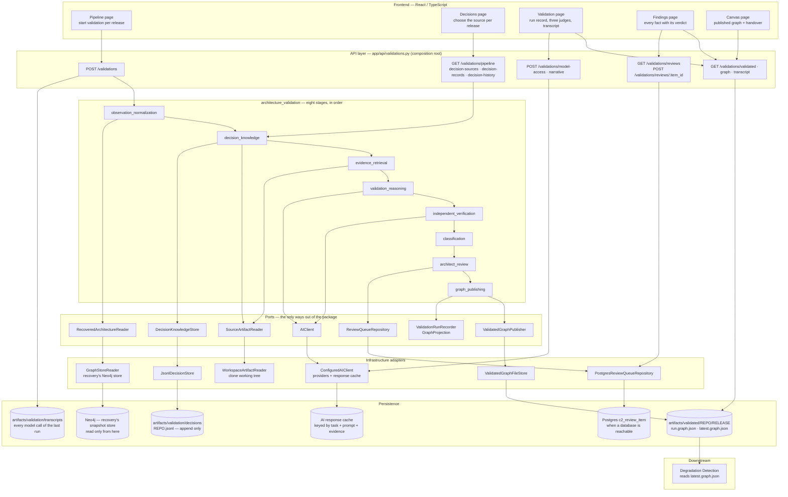

# Architecture Validation — current architecture

**Component:** `backend/app/components/architecture_validation/`
**Status:** implemented and running. This document records **what exists today**, not what is planned.
**Reads:** a recovered architecture (recovery's graph store or a recording), the repository files the decision sources parse, and the decision history accumulated for that repository.
**Produces:** one validated architecture graph per release, published as `latest.graph.json` with every verdict carried on the relationship it describes.

> Companion documents: [`architecture-recovery.md`](./architecture-recovery.md), `degradation-detection.md`, `degradation-scoring.md`.

---

## 1. What the component does

Architecture validation decides whether the architecture recovery found is the architecture that was **intended**, and publishes that judgement as a graph rather than as a list of opinions. It turns the recovered architecture into one uniform set of facts, establishes which recorded decision governed each fact at that release, and assembles exactly the evidence a model is allowed to reason from. A model reaches a verdict, a *different* model is asked what is wrong with that verdict, and a deterministic table with no model in it decides whether the two are believed — three judges, two of them models. The result is a bucket, a confidence with its arithmetic published, and a route: publish, or hold for an architect.

The judgement travels **on the edge** it describes, so the consumer never joins a findings list back onto a topology. It is the only component that calls a model, and it is built so that a machine with no model still finishes: every governed fact gets a verdict from the deterministic table, each one saying so on its face.

**Composition:** the eight stages and their order live in the component's own service (`service.py`); the transport only composes them. Subcomponents never import each other, and nothing outside the package imports a subcomponent — `ArchitectureValidationService` is the single way in.

---

## 2. Connection map



**Reading the map.** The frontend never touches a model, a database or the artifacts directory; it calls the API. The component reaches the outside world only through eight protocols, which is what lets a run be exercised end to end with any part faked. Recovery's graph is read here, never written; the validated graph is written here, and detection is its only consumer.

---

## 3. Subcomponents

Eight stages, all implemented (`PIPELINE` in `pipeline.py` marks each one `implemented=True`, and structural tests hold the code to that claim).

| # | Unit | Research module | Uses a model | Role |
| - | ---- | --------------- | ------------ | ---- |
| 1 | `observation_normalization` | M1 | no | recovered architecture into canonical facts |
| 2 | `decision_knowledge` | M2 | no | the decision history, and which decision governed at a release |
| 3 | `evidence_retrieval` | M3 | no | the sealed evidence package one fact may be judged from |
| 4 | `validation_reasoning` | M4 | yes | one verdict per fact, against the governing decision |
| 5 | `independent_verification` | M5 | yes | a challenge to that verdict, from a different model |
| 6 | `classification` | M6 | no | bucket, confidence and route, capped by evidence strength |
| 7 | `architect_review` | M7 | no | hold back what the system will not decide alone |
| 8 | `graph_publishing` | M8 | no | the validated graph, written for the next component |

### 3.1 `observation_normalization`

Turns a recovered architecture into one uniform fact shape, whatever architectural style it came from. It selects a style adapter from a registry — microservices, layered, event-driven, monolith, or a generic fallback — and reduces that style into two canonical relationship kinds, `communicates-with` and `depends-on`, with everything style-specific kept as attributes. Element names are reduced to one canonical identity, and two names that collide inside a release are reported rather than silently merged. It performs no I/O and repeats none of recovery's discovery; its value is uniformity and identity, not finding things.

- **Inputs:** `RecoveredArchitecture` through the `RecoveredArchitectureReader` port.
- **Produces:** observed facts, the release's ordering key, and the resolved style with its source.

### 3.2 `decision_knowledge`

Holds the architectural decisions as an append-only history and answers which one governed a relationship at a given release. Three sources sit behind one protocol, chosen per run and recorded on the result: decision records in this repository, records in a repository the user names, and — for `combined` — this repository's own records plus rules reconstructed from its configuration. Validity intervals are half-open, so a superseded rule stops governing at the release that replaced it, and the history accumulates across runs because learning that a rule was withdrawn means comparing a release against what the log already holds. A mode that would supply nothing stops the run before any stage rather than publishing a graph that reads like a clean one.

- **Inputs:** `SourceArtifactReader` (paths come from recovery's inventory) and `DecisionKnowledgeStore`.
- **Produces:** the decision history state for this release, a `Resolution` per fact, and the mode that supplied it.

### 3.3 `evidence_retrieval`

Assembles exactly what the model is allowed to reason from, for one fact. The model never reads the repository — it reads one package — and that single property is what makes a citation checkable, two runs over one release ask an identical question, and the cost of a run decided here rather than by whatever a file happens to contain. Every item carries a `ref`, a `role` (a replaced decision is presented as context, never as a rule) and a span where one exists. Nothing is ranked or scored: items are selected by identity, which is the retrieval hypothesis the research measures against keyword and embedding baselines.

- **Inputs:** the fact, its resolution, the architecture, and `SourceArtifactReader`.
- **Produces:** a fixed, ordered, hashed `EvidencePackage` per fact.

### 3.4 `validation_reasoning`

Judges one fact against the decision that governs it, under an enforced response schema and a versioned prompt, and checks every citation the model makes against the package it was given. It climbs a ladder of configured tasks, so a model that cannot be reached is followed by the next one rather than by a failure, and every verdict records which rung answered. When no model answers at all the ladder ends at the deterministic arbiter — unless the run forbids that, in which case it fails loudly rather than presenting a table's answer as a model's.

- **Inputs:** the evidence package, the arbiter's table lookup, and `AIClient`.
- **Produces:** a `PrimaryVerdict` per fact with its source, model and prompt version.

### 3.5 `independent_verification`

Re-examines a verdict as a challenge to it, using a different model and a different framing. It is given one task and not a ladder, deliberately: falling back to the reasoner's model would produce a verification that looks real while being the first model endorsing its own answer. A finding may lower a conclusion and never raise one. The `informed` arm shows the evidence and the first verdict and returns objections an architect can act on; the `blind` arm shows the evidence only; `both` runs three model calls per fact and measures how much being shown the answer moves the second model.

- **Inputs:** the primary verdict, the evidence package, and `AIClient`.
- **Produces:** a `Verification` per fact, or an explicit `unavailable` outcome that is never rendered as agreement.

### 3.6 `classification`

Turns a verdict and its verification into a bucket, a confidence and a route, using two lookup tables and one threshold in plain code. The second table caps the bucket by the tier of the source the decision came from, so a rule inferred from a convention can never produce a confident accusation — the ceiling is applied after the model answers, so it holds when the model is wrong. Buckets are `confirmed`, `contradicted`, `ambiguous`, `uncovered`, `convention_deviation`, `insufficient_evidence` and `needs_review`; the route is `publish` or `review`. The arithmetic behind the confidence travels with it as `score_trace`.

- **Inputs:** the fact, its resolution, the verdict, the verification and that fact's own verification mode.
- **Produces:** a `ClassifiedFact` — bucket, confidence with its terms, and route.

### 3.7 `architect_review`

Queues the facts the system will not decide alone and records what a person decided. An accepted item can ratify a candidate decision back into the knowledge history, and the count of versions it touched is returned so a confirmation that matched nothing is visible. `enqueue` is idempotent on a content-addressed id, so a re-run of a release cannot queue the same fact twice and a settled question keeps its decision. Nothing downstream reads the queue: an empty, stale or unreachable queue cannot change a verdict, a confidence or the published document, and a run with no queue says so in a note rather than failing.

- **Inputs:** the classified facts and, optionally, `ReviewQueueRepository`.
- **Produces:** queued review items, and the record of decisions taken on them.

### 3.8 `graph_publishing`

Builds the validated architecture graph and writes it, with each verdict attached to the relationship it describes and every fact present — including uncovered ones, because an omitted fact is a quietly incomplete graph the consumer cannot detect. The file is written first and a failure there fails the run; the relational record and graph projection follow and may fail, because both are rebuildable from the document. Publishing is gated on the six fact-producing stages, so a partial run writes nothing and `latest` still resolves to the last release that finished.

- **Inputs:** the run result and the recovered architecture.
- **Produces:** `latest.graph.json` (+ a per-run copy) through `ValidatedGraphPublisher`, and optionally the record and projection through the other two ports.

---

## 4. Execution and failure semantics

```
POST /validations  {repository_id, release_id, decision_mode, adr_repository_id?, arm?, verify?, fresh?, released_at?}
      decisions established  ->  observation_normalization  ->  [ per fact: evidence -> reason -> verify ]  ->  classification
      ->  architect_review  ->  graph_publishing  ->  transcript written by the API
```

- **One release at a time, started by a person.** The pipeline runs each release in turn; the source it is judged against is chosen per release on the decisions screen, never defaulted.
- **Short-circuits live in the service.** A fact no decision governs never reaches a model: it is classified `uncovered` with provably zero model calls, rather than with a call whose result was discarded.
- **The three judges are separate.** Reasoning may try more than one model in order; verification may not. An unreachable verifier produces `unavailable` — never agreement — and classification caps the confidence accordingly.
- **A missing model degrades, and says so.** With no key the ladder ends at the deterministic table, every governed fact still gets a verdict, and each one records `produced_by: table`.
- **Concurrency is bounded by the provider, not the machine.** Facts may wait on models in parallel (`ai_concurrency`); nothing that decides anything overlaps, so the published document and its counts are identical either way.
- **A partial run publishes nothing.** If any fact-producing stage is `pending` or `failed`, publishing is skipped with the reason and `latest` keeps the last complete release.
- **Failures are typed at the API.** An unorderable release identifier is `422`; a repository that is not ingested, has no recovered architecture, or carries an unreadable schema is `409`; a missing model for the narrative is `503`.

---

## 5. Persistence

### 5.1 What a run leaves behind

| Artifact | Path | Written by | Wired today |
| -------- | ---- | ---------- | ----------- |
| validated graph | `artifacts/validated/<repository_id>/<release_id>/<run_id>.graph.json` and `latest.graph.json` | `ValidatedGraphFileStore` | **yes** — the only required store |
| decision history | `artifacts/validation/decisions/<repository_id>.jsonl`, append only | `JsonlDecisionStore` | **yes** |
| model transcript | `artifacts/validation/transcripts/<repository_id>/<release_id>.json` | `ModelTranscriptFileStore`, called by the API after the run | **yes** |
| AI response cache | `ai_cache_directory`, keyed by task, prompt version, model, schema mode, evidence hash and effort | `ConfiguredAIClient` | **yes** (enable/disable via settings) |
| review queue | PostgreSQL `c2_review_item` | `PostgresReviewQueueRepository` | **conditionally** — bound only when a database answers, otherwise the stage reports no queue |
| relational run record | PostgreSQL `c2_validation_run`, `c2_stage_record`, `c2_classified_fact`, `c2_element`, `c2_primary_verdict`, `c2_verification`, `c2_objection` | `PostgresValidationRunRecorder` | **no** — implemented and tested, not passed by the composition root |
| graph projection | Neo4j `(:Release)`, `(:Element)`, `-[:VALIDATED_DEPENDENCY]->` | `ValidatedGraphProjection` | **no** — implemented and tested, not passed by the composition root |

Both unwired stores are optional by design: `GraphPublishingService` treats `None` as *not configured* and only warns about a store that exists and refused. A default run therefore reports `written to file`, and that is the honest answer.

### 5.2 The published document

```
{
  "directed": true,
  "multigraph": false,
  "graph": { schema_version, generator, repository_id, release_id,
             released_at, released_at_source, release_order_key,
             c1_model_ref, architecture_style, architecture_style_source,
             validation_confidence, run{...}, summary{...} },
  "nodes": [ element + validation rollup + size ],
  "links": [ source, target, kind, bucket, confidence, score_trace,
             route, produced_by, verification_outcome, arbiter_agreement,
             evidence_hash, ... ]
}
```

The edge list is written under **`links`**, not `edges`; consumers must read it with `nx.node_link_graph(document, edges="links")`. The document refuses to exist in two states: a confidence outside `0..1`, and two elements measuring size in different units within one release.

### 5.3 Where the graph is read from, and where it goes

| Reader | Source | Selected by |
| ------ | ------ | ----------- |
| `GraphStoreReader` | recovery's Neo4j store — the live path | `architecture_source = graph` |
| `SnapshotFileReader` | a recorded snapshot | `architecture_source = snapshot` |
| `InventoryFileArchitectureReader` | an inventory recording | `architecture_source = inventory` |

There is no silent fallback between them: whichever answered is stamped on the run's provenance.

---

## 6. API surface

All routes live in `app/api/validations.py` under `/validations`. Every one below is called by a screen that exists.

| Method | Path | Purpose | Used by |
| ------ | ---- | ------- | ------- |
| `POST` | `/validations` | validate one release; returns the run with one record per stage | Pipeline |
| `GET` | `/validations/pipeline` | the eight stages, their order, and what each is for | Pipeline, Validation |
| `GET` | `/validations/decision-sources` | what each mode would supply for that release | Decisions |
| `GET` | `/validations/decision-records` | the rules one mode supplies, with their provenance | Decisions |
| `GET` | `/validations/decision-history` | what each scanned release changed in the history | Decisions |
| `GET` | `/validations/validated` | which releases of a repository have a published graph | Pipeline |
| `GET` | `/validations/graph` | the published graph for one release | Validation, Findings, Canvas |
| `GET` | `/validations/transcript` | every call the last run made, and what came back | Validation, Canvas |
| `POST` | `/validations/model-access` | ask each configured model a trivial question, now | Validation |
| `POST` | `/validations/narrative` | the run read back as prose (needs a model; `503` without one) | Validation |
| `GET` | `/validations/reviews` | facts held for an architect | Findings |
| `POST` | `/validations/reviews/{item_id}` | record an architect's decision on one fact | Findings |

---

## 7. Frontend consumers

| Screen | Reads | Why it exists |
| ------ | ----- | ------------- |
| Pipeline (`features/pipeline`) | `POST /validations`, `/validated`, `/pipeline` | starts a release, waits for every release to be judged before detection unlocks |
| Decisions (`features/decisions`) | `/decision-sources`, `/decision-records`, `/decision-history` | chooses what each release is judged against, and shows what each source would supply |
| Validation (`features/validation`) | `/graph`, `/transcript`, `/pipeline`, `/model-access`, `/narrative` | the three judges side by side, the stage record, and the calls themselves |
| Findings (`features/findings`) | `/graph`, `/reviews`, `POST /reviews/{id}` | every dependency with its verdict, and the facts held for a person |
| Canvas (`features/canvas`) | `/graph`, `/transcript` | the published graph drawn, plus what is handed on |

Every screen above is a real page wired to the endpoints in §6; none is a reserved placeholder. The **Drift** and **Scoring** screens belong to the later components and are out of scope here. The narrative panel is live-model only: with no model configured it reports the refusal rather than inventing prose.

---

## 8. Inputs and outputs at a glance

**Takes**

- a repository identity and an **orderable** release identifier (a date stamp or build label is refused);
- where the decisions come from — `repo_adr`, `external_adr` (which needs the second repository's id) or `combined`;
- a run's shape: `verify` (second model on/off), `arm` (`informed` / `blind` / `both`), `fresh` (bypass the response cache);
- optionally `released_at`, when the tag date cannot be read from the workspace.

**Reads**

- the recovered architecture for that release, through the configured reader;
- repository files the decision sources parse, at paths recovery's inventory supplies;
- the decision history already accumulated for that repository;
- model responses, live or from the cache.

**Produces**

- `latest.graph.json` — the validated architecture, one verdict per relationship;
- the decision history additions for this release;
- the run result: eight stage records, one classified fact per relationship, the model names and prompt versions used, and the run's own confidence;
- a model transcript for the run, and (when a database is reachable) review items for the facts a person must decide.

**Never produces**

- a relationship left out of the graph — uncovered facts are published as findings, not dropped;
- a claim that a check passed when it did not run;
- a partial graph, or a graph in a mixed size unit;
- any write to recovery's store.

---

## 9. Invariants worth preserving

1. **The verdict travels on the edge.** A separate findings list would have to be joined back onto a topology, and a join is where two sides disagree about what the topology was.
2. **Evidence strength caps the conclusion.** Applied in code after the model answers, so it holds when the model is wrong.
3. **An absent check never looks like a passed check.** `unavailable` and `not_requested` are reported as themselves, in the stage note and on every fact.
4. **The verifier is never the reasoner.** One task, no ladder — a model endorsing its own answer is the most misleading output this component could produce.
5. **No decision, no model call.** Uncovered facts reach their bucket with provably zero calls.
6. **Nothing is published from a partial run.** `latest` keeps resolving to the last release that finished.
7. **The file is the contract.** The record and the projection are rebuildable from it; a failure to write the file fails the run.
8. **A model choice is never hard-coded.** Subcomponents name a task; the adapter resolves the model, and the name that answered is published with the run.
9. **The decision history is append-only.** A past release must stay explainable after the answer changes.

---

## 10. Boundaries

- **No source-code reading for discovery.** Verification of intent reads manifests, contracts and records; the architecture under judgement comes from recovery.
- **No cross-release comparison.** One run judges one release; comparing releases is degradation detection's job.
- **No repair of the architecture.** A contradiction is reported, never fixed here.
- **No workflow.** The review queue is one list, one decision — no claiming, assignment or priority.
- **Implemented but not wired:** the PostgreSQL run record and the Neo4j projection. Both exist, are tested, and are one argument each in `get_validation_service`; until then a run honestly reports that it wrote the file store alone.
