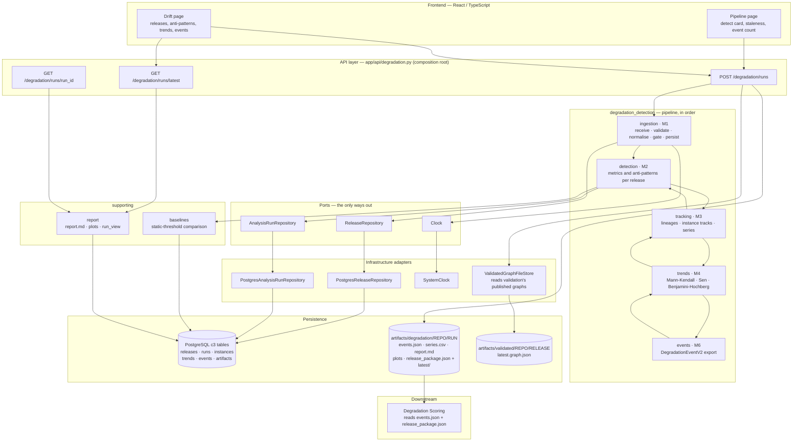

# Degradation Detection — current architecture

**Component:** `backend/app/components/degradation_detection/`
**Status:** implemented and running for the trend-only baseline (PP1). Context, retrieval and LLM stages are configured but deliberately disabled.
**Reads:** the validated graph of **every** validated release of one repository, from the directory validation publishes to.
**Produces:** one stored analysis run per repository — per-release anti-pattern instances, cross-release lineages and series, Mann-Kendall/Sen trends with corrected q-values, and the degradation events handed to scoring.

> Companion documents: [`architecture-recovery.md`](./architecture-recovery.md), [`architecture-validation.md`](./architecture-validation.md), `degradation-scoring.md`.

---

## 1. What the component does

Degradation detection asks a question one release cannot answer: **is this system getting worse?** It reads every validated release of a system in order, turns each into a release package, and measures each one on its own — coupling, size, cycles, modularity, and the anti-patterns that follow from them. It then lines the releases up: elements are aligned across consecutive releases so a renamed service keeps one history, anti-pattern instances are tracked into series, and every series is tested for a monotone trend with Mann-Kendall and Sen's slope. Benjamini–Hochberg correction over the whole run keeps the false discovery rate honest when hundreds of series are tested at once, and an event is emitted for each anti-pattern whose measure is moving in its defined *worsening* direction with statistical support.

It is deterministic code over a handful of releases — no model, no LLM, no random seed that varies — and finishes in seconds, so the API runs it synchronously. "Worse" is decided by a trend, never by a fixed threshold; the static-threshold baseline is computed only so the report can say what a conventional tool would have flagged instead.

**Composition:** the pipeline order lives in the component's own service (`service.py`), which passes artifacts between subcomponents; subcomponents never import each other. The transport composes the service and nothing else.

---

## 2. Connection map



**Reading the map.** The only input is validation's published graph: the API reads `latest.graph.json` for every validated release, converts each to a release package, and hands the packages to the component's ingestion — which is also its only door. A run is stored as `RUNNING` before the analysis stages and finished once. The files under `artifacts/degradation/` are the handover to scoring; the database is how the drift screen reads the same run back.

---

## 3. Stages

Five implemented stages, plus two supporting services. Module ids follow the research plan.

| # | Unit | Module | Deterministic | Role |
| - | ---- | ------ | ------------- | ---- |
| 1 | `ingestion` | M1 | yes | release packages in, canonical releases stored, timeline out |
| 2 | `detection` | M2 | yes | metrics and anti-pattern instances for one release |
| 3 | `tracking` | M3 | yes | element lineages, instance tracks and the series to test |
| 4 | `trends` | M4 | yes | which series are worsening, with corrected significance |
| 5 | `events` | M6 | yes | `DegradationEventV2` for each worsening anti-pattern |
| — | `baselines` | — | yes | static thresholds, for comparison only |
| — | `report` | — | yes | the human report, plots and the screen's document |

### 3.1 `ingestion` (M1)

The only door into the component. A package goes Receive → Validate → Normalise → Idempotency → Gate → Persist, and a package that fails any step before Persist is rejected with a reason code and never touches the store, so one bad release cannot leave half of one behind. The **gate** turns validation's confidence into a status: `ACCEPTED` at or above 0.70, `DOWNWEIGHTED` at or above 0.50, `EXCLUDED` below it — an excluded release is kept for the record and listed on every report, but kept off the analysis. Re-ingesting a release whose package hash changed replaces it; an unchanged one is left alone. The timeline is a separate, pure query over what was stored: main release line only (`^v?\d+\.\d+\.\d+$`), ordered by date.

- **Inputs:** release packages (from validation's graphs, or files through the CLI), plus `ReleaseRepository`, `Clock` and the config.
- **Produces:** stored `c3_release` rows with their elements, edges and datastore access; a `Timeline` of the releases that are on it.

### 3.2 `detection` (M2)

Builds a release's graph, computes every metric the registry declares, chooses the detectors for that release's style, and runs them. The metrics are element-level (`fan_in`, `fan_out`, normalised variants, `instability`, `size`, robust z-score, SCC size, unstable-dependency ratio) and system-level (`scc_count`, `largest_scc_share`, `cyclic_edge_count`, `modularity`, plus a count per anti-pattern and an involvement share). Detectors are the universal tier — `CyclicDependency`, `HubLikeElement`, `UnstableDependency`, `OversizedElement`, `BigBallOfMud` — plus `SharedPersistence` for microservices, which is skipped with `CATALOG_INPUT_MISSING` when a release carries no `datastore_access`. The registry is the **only** place in the component that branches on architecture style.

- **Inputs:** one canonical release, plus thresholds from `configs/default.yaml` and the catalog from `configs/catalog.yaml`.
- **Produces:** observations and anti-pattern instances for that release, with the ids of the detectors that actually ran.

### 3.3 `tracking` (M3)

Aligns elements between consecutive releases so the same service keeps one history, and turns anti-pattern instances into tracks and series. Similarity combines name, neighbours and size (0.4 / 0.4 / 0.2), with separate thresholds for a rename, an ambiguity margin, and a split or merge; below the bar the history is **broken rather than guessed**, because a wrong link can invent a trend with a real p-value. Series are then built in three scopes — element metrics, system metrics, and per-instance measures.

- **Inputs:** the timeline and M2's per-release detections.
- **Produces:** lineages, rename events, alignment decisions, instance tracks with transitions (`INTRODUCED` / `GREW` / `SHRANK` / `PERSISTED`), and the series to test.

### 3.4 `trends` (M4)

Tests every series that can be tested. A metric with no worsening direction (`instability`) is never acted on and so is never tested; a series with fewer than **8** non-null points is too short — both are reported as untested with their reason rather than dropped. The test is Mann-Kendall on the non-null values in order, with the **ordinal** as the time axis so a missing release stays a gap in time. Sen's slope gives the magnitude. Benjamini–Hochberg runs over every series tested in the run as one family, and the gate is the corrected `q` at `alpha = 0.05`. `is_worsening` takes its sign from the metric's declared direction, so a significant *improvement* is never reported as a degradation.

- **Inputs:** series, the metric/detector catalog (worsening directions), and the trend config.
- **Produces:** a `TrendResult` for every tested series and an `UntestedSeries` with a reason for the rest.

### 3.5 `events` (M6)

Turns each worsening candidate into a `DegradationEventV2` and validates the whole export against the JSON Schema generated from the contract model, so scoring never receives an event its schema rejects. The event id is `DEG-` plus the start of `sha256(run_id, event_key)`, so a replayed run produces byte-identical output. Provenance lists every release in the window with its package hash and each C1/C2 reference once. Context is disabled — `R0_CONTEXT_DISABLED`, the trend-only ablation baseline — so an event states *that* something is worsening and how strong the evidence is, and says nothing about severity.

- **Inputs:** event candidates, the timeline, the run id and the config hash.
- **Produces:** the exported events (`events.json`), also stored per run.

### 3.6 `baselines` (supporting)

Computes what a fixed-threshold tool would have flagged on the last release — by default `fan_in > 10` and `size > 10 000`. It is there for comparison only: degradation is decided by the trend, and the static flags are published as a separate collection so the two can never be confused. A rule naming an element metric M2 does not measure fails the run at start-up rather than silently flagging nothing.

- **Inputs:** the last release's detections and the baseline rules.
- **Produces:** `static_flags` stored beside the run.

### 3.7 `report` (supporting)

Renders `report.md` plus one plot per event, and builds `run_view` — the single JSON document the drift screen draws. Everything is read from what the run stored: its outputs, its JSON artifacts and the stored releases for their graphs. Nothing is recomputed, because a second computation of a number is a second implementation of it. Releases that are stored but off the timeline are listed with the reason (`not on the main release line`, `validation confidence below the exclusion threshold`, `stored after this run`), so a gated-out release is visible rather than missing.

- **Inputs:** a stored run, its artifacts, and the stored releases.
- **Produces:** `report.md`, `plots/<event_id>.png`, and the run document the API returns.

---

## 4. Execution and failure semantics

```
POST /degradation/runs {repository_id}
      read every validated release  ->  convert each to a release package  ->  ingest
      ->  ingest_validated (STORED | UNCHANGED | REPLACED | REJECTED, one per graph)
      ->  run:  timeline -> detection -> tracking -> trends -> events -> static baseline
      ->  store COMPLETED  ->  write handover files  ->  return the run document
```

- **A run is stored before the analysis stages, and finished exactly once.** `RUNNING` when it starts; `COMPLETED` with every output in one transaction, or `FAILED` with the error and no outputs. The config and its hash, the code version, library versions, stage timings and reason-code counts travel with it, so any number can be traced to the run that produced it.
- **One bad graph does not stop the others.** Each published graph is converted separately; one without a release date is refused with `RELEASE_UNDATED` and reported, and the rest go on. If nothing can go on the timeline the request is `409` with the per-graph outcomes.
- **Nothing to read is a state, not a failure.** No validated release is `404` with a sentence; a repository detection has never run for is a `404` the screen renders as its empty state.
- **Re-validation is picked up automatically.** A release validation has published again replaces the stored one on the next detect; an unchanged one is left as it is.
- **Deterministic end to end.** No model, no wall-clock in any number, fixed seed for the permutation test, ids derived from content — a re-run of the same inputs reproduces the same document.

---

## 5. Persistence

### 5.1 PostgreSQL — the run and its releases

| Table | Holds |
| ----- | ----- |
| `c3_release` | one row per (system, release): dates, style, granularity, validation confidence, gate status, package hash, provenance, the raw package |
| `c3_element_snapshot` | elements per release: name, kind, size and unit, aliases, layer, metrics |
| `c3_dependency_edge` | aggregated edges per release with their types and count |
| `c3_datastore_access` | the datastore rows `SharedPersistence` needs |
| `c3_intent_entry` | intent carried on a package, when supplied |
| `c3_analysis_run` | the run: status, config + hash, code and library versions, timeline, timings, reason counts, error |
| `c3_ap_instance` | anti-pattern instances per release, in output order |
| `c3_trend_result` | every tested series — and the untested ones with their reason |
| `c3_degradation_event` | the exported `DegradationEventV2` payload per event |
| `c3_static_flag` | the comparison baseline's flags |
| `c3_run_artifact` | the JSON artifacts kept for audit (`catalog`, `detections`, `lineages`, `lineage_events`, `alignment_decisions`, `tracks`, `series`) |

### 5.2 Files — the handover to scoring

```
artifacts/degradation/<repository_id>/
├── <run_id>/
│   ├── events.json            the DegradationEventV2 export
│   ├── series.csv             every series the run built
│   ├── report.md              the run for a person
│   ├── plots/<event_id>.png   one per event
│   └── release_package.json   the package of the window's last release
└── latest/                    a whole copy of the most recent run
```

`latest/` is replaced only after the run's own directory is complete, so it always holds one whole run. Scoring reads these files directly (`scripts/c4_rank.py --events … --graph …`), which is why a run started from the screen leaves exactly what a CLI run leaves.

### 5.3 The one input

`artifacts/validated/<repository_id>/<release_id>/latest.graph.json` — validation's published graph. The adapter turns each node into an element (datastores become `datastore_access` rows instead), every edge into a dependency **whatever its verdict** — a contradicted dependency still exists, and dropping it would hide the coupling this component is looking for — and carries validation's confidence, run id and model reference as provenance.

---

## 6. API surface

`app/api/degradation.py`, prefix `/degradation`. All three routes are used by the application.

| Method | Path | Purpose | Used by |
| ------ | ---- | ------- | ------- |
| `POST` | `/degradation/runs` | ingest every validated release, run detection, write the handover | Pipeline, Drift |
| `GET` | `/degradation/runs/latest` | the most recent completed run as the drift screen reads it | Drift (and the workspace on load) |
| `GET` | `/degradation/runs/{run_id}` | one stored run by id | available; no screen calls it today |

A run is synchronous on purpose: detection is deterministic code over a few releases and finishes in seconds, and a job queue would add a state the screen has to poll for no gain.

---

## 7. Frontend consumers

| Screen | Reads | Why it exists |
| ------ | ----- | ------------- |
| Pipeline (`features/pipeline`) | `POST /degradation/runs`, latest run | the detect phase: start it, see whether the stored run is stale, open the result |
| Drift (`features/drift`) | `POST /degradation/runs`, `/runs/latest` | every validated release in order — the strip, each release's graph, its anti-patterns, the trends and the events handed on |

The Drift screen is composed of four data-driven panels and the shared graph renderer:

- **`ReleaseStrip`** — the releases in timeline order with gate status and confidence.
- **`GraphCanvas`** — each release's validated graph, in layout positions fixed across releases so stepping through them reads as one system changing.
- **`AntiPatternTable`** — instances per release, with the track and transition once tracking has linked them.
- **`TrendCharts`** — the tested series with τ, corrected q and Sen's slope, and the untested ones with their reason.
- **`EventsHandover`** — the exported events and the paths scoring will read.

Every one of these is wired to the report document; nothing here is a placeholder. The detect card on the Pipeline page reads the same stored run through the workspace, so the two screens cannot disagree.

---

## 8. Inputs and outputs at a glance

**Takes**

- one repository identity — the key validation publishes under;
- the validated graphs of its releases;
- `configs/default.yaml` (thresholds, gate, alignment, trend parameters) and `configs/catalog.yaml` (which detectors run per style), both folded into the run's `config_hash`.

**Reads**

- `latest.graph.json` for every validated release of that repository;
- the releases already stored, to build the timeline and to show what is off it.

**Produces**

- one stored analysis run: stage timings, reason counts, and every intermediate artifact;
- per release: metrics and anti-pattern instances, plus which detectors ran;
- across releases: lineages, instance tracks, and tested/untested trends with their statistics;
- degradation events — one per anti-pattern worsening in its declared direction with corrected significance;
- the handover files, and one JSON document for the screen.

**Never produces**

- a severity, a priority or a ranking — that is scoring's question;
- a verdict on a single release in isolation — "degradation" here always means a trend across releases;
- a model call of any kind.

---

## 9. Invariants worth preserving

1. **A trend decides degradation, never a fixed threshold.** The static baseline exists only to be compared against.
2. **Unsure means broken, not joined.** An alignment below the threshold splits a history instead of inventing one.
3. **A null is a gap, never a zero.** Missing points stay missing in the series and in the test.
4. **All series in a run are one family.** Benjamini–Hochberg runs over the run, so adding tests cannot silently loosen the others.
5. **The sign is the metric's, the p-value is two-sided.** A significant improvement is never an event.
6. **Everything is reported, including what was not tested** — with the reason, on the screen and in the store.
7. **A run is all or nothing.** `COMPLETED` with every output, or `FAILED` with none; never a half-stored run.
8. **The output is reproducible.** Content-derived ids, a fixed seed, and a recorded `config_hash`.
9. **One door in.** Release packages enter through ingestion's validate/normalise/gate, never directly into the store.

---

## 10. Boundaries

- **Trend-only baseline (PP1).** Context, change-point detection, retrieval, LLM classification and review are configured but switched off; events carry `R0_CONTEXT_DISABLED` and no severity.
- **No code or history mining.** Change frequency, authorship and co-change belong to scoring, not here.
- **No single-release judgement.** With fewer than `min_releases` (default 8) points, a series is reported untested — a two-release repository still gets per-release anti-patterns, and no events.
- **No cross-component writes.** Recovery's and validation's stores are read-only from here; the only writes are the `c3_*` tables and the handover directory.
- **The `stub` package is not in the application path.** It generates synthetic series for evaluation and tests (`scripts/c3.py`, `scripts/mvp_eval.py`); the API never imports it. The CLI (`scripts/c3.py`) is an alternative entry point that writes the same artifacts the API does.
