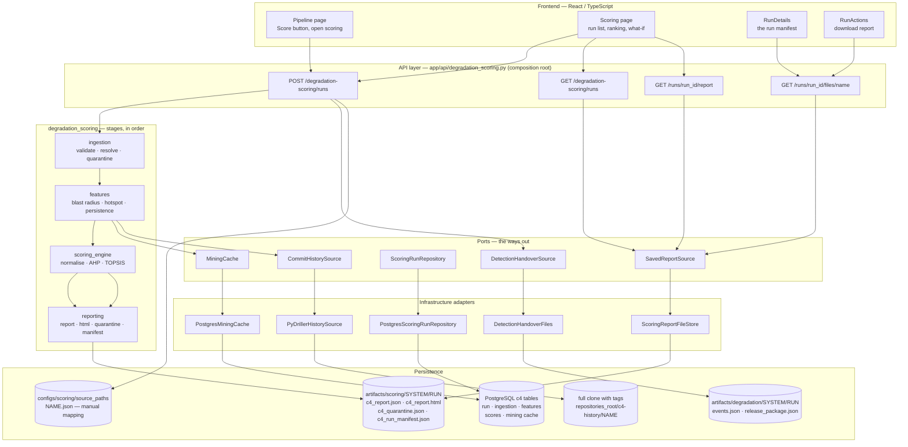

# Degradation Scoring — current architecture

**Component:** `backend/app/components/degradation_scoring/`
**Status:** implemented and running. This document records **what exists and is wired today** — the four stages the API and the scoring screen actually execute.
**Reads:** the degradation events and the release package that detection left as its hand-over, plus (when available) the repository's git history and a manual element-to-path mapping.
**Produces:** one saved scoring run per detection run — a ranked severity report as JSON, a standalone HTML page, a quarantine list, and a run manifest — stored as files and in PostgreSQL.

> Companion documents: [`architecture-recovery.md`](./architecture-recovery.md), [`architecture-validation.md`](./architecture-validation.md), [`degradation-detection.md`](./degradation-detection.md).

---

## 1. What the component does

Degradation detection says *what* is getting worse and how strong the evidence is. Scoring answers the question that follows: **how much does each of those matter, and which one first?** It ranks the events detection confirmed by four severity criteria — blast radius, hotspot, decision violation, persistence — where each criterion is itself a small set of measured sub-criteria. Sub-criteria are normalised to `[0, 1]`, weighted with AHP pairwise judgements, and combined with TOPSIS, so an event's severity is a number traceable to the measurements behind it rather than a judgement applied on top.

Only the criteria a run can actually support are active: hotspot needs the repository's commit history, decision violation needs an ADR index. An inactive criterion is not silently zero-weighted — it is reported as inactive, with the reason, and the ranking is computed over what remains. Every event that came in is accounted for: ranked, quarantined because it could not be resolved onto the graph, or skipped for a stated reason. Nothing is dropped.

**Composition:** the pipeline order lives in the component's own service (`service.py`); subcomponents never import each other and receive what they need as arguments.

---

## 2. Connection map



**Reading the map.** Scoring never reads detection's database — its input is the hand-over directory detection writes, so the two components meet on files. The scoring screen never computes a ranking itself: it reads the saved report, and the what-if card re-ranks in the browser from the numbers already in that report, without saving anything. The PostgreSQL rows are written on the run path and are not read back by any endpoint today; the read side is the file store.

---

## 3. Stages

Four stages, all wired end to end. `explanation` and `evaluation` exist in the package but are outside the running path — see §10.

| # | Unit | Deterministic | Role |
| - | ---- | ------------- | ---- |
| 1 | `ingestion` | yes | validate detection's events, decide what may be ranked, resolve them onto the release graph |
| 2 | `features` | yes | measure the severity criteria for each resolved event |
| 3 | `scoring_engine` | yes | normalise, weight with AHP, rank with TOPSIS |
| 4 | `reporting` | yes | write the JSON report, the HTML page, the quarantine list and the manifest |

### 3.1 `ingestion`

Opens detection's `events.json` and the release package of the window's last release, checks each event against the `DegradationEventV2` contract, and splits the payloads three ways: **eligible** to be ranked, **quarantined** because the payload is malformed, and **skipped** for a stated reason — not confirmed, rejected, intentional, system-scope, or superseded. Every eligible event is then resolved onto the release graph, exact id first and a prefix fallback second, with the confidence recorded; an event whose elements cannot be found is quarantined as `unresolved_element` rather than ranked against a guess. The resolution rate is computed here and carried into the report, because an event that vanished into quarantine is invisible otherwise.

- **Inputs:** the raw event payloads and the release package graph, from `DetectionHandoverSource`.
- **Produces:** resolved events with their graph nodes, the quarantine and skip lists, the per-payload audit records, and the resolution rate.

### 3.2 `features`

Computes the severity criteria for each resolved event, against that release's graph:

- **Blast radius** — fan-in ratio, PageRank and betweenness centrality of the affected elements, plus the deepest node among them. Betweenness is exact below a configured node count and sampled above it with a fixed seed, and the sampling is flagged on the row.
- **Hotspot** — churn decayed by release half-life, distinct authors, co-change coupling and bug-fix ratio, mined from git history between the window's release tags. Files are filtered by include/exclude globs, and one commit touching more than `max_files_per_commit` files is not counted as coupling.
- **Persistence** — how many consecutive releases the instance has lasted, and the slope of its growth.
- **Decision violation** — reserved for an ADR index; inactive on the application's path, since no index is supplied there.

An event whose features span more than one `(system, release)` pair is refused outright, because a ranking across two releases would be a comparison nobody asked for.

- **Inputs:** resolved events, the release graph, an optional repository path, an optional ADR index, and the mining cache.
- **Produces:** one feature row per event, plus which criteria are active and — for each inactive one — why.

### 3.3 `scoring_engine`

Normalises each sub-criterion to `[0, 1]` (robust min–max, falling back to plain min–max for small n), derives the criterion weights by AHP from pairwise judgements — publishing the consistency ratio, so weights whose judgements contradict each other are visible — and ranks the events with TOPSIS. The default is **fixed reference**: the ideal point is the weight vector and the anti-ideal is zero, which makes a score depend only on the event's own values and the weights. That property is what lets the screen re-rank with different weights and get the saved scores to the last digit when the saved weights are used.

- **Inputs:** raw feature rows and the active criteria.
- **Produces:** normalisation bounds, the weight vector with its provenance and consistency ratio, and one severity score and rank per event.

### 3.4 `reporting`

Builds the `SeverityReportV1` document — the ranked records, the quarantine and skip lists, the active dimensions, the weights and the normalisation bounds — then writes four files into the run's own directory. The JSON is re-validated against the contract before it is written, so a report that does not round-trip fails rather than reaching a screen. The HTML page is rendered from a template with no JavaScript, and the manifest records how the run was made: code commit, an input fingerprint for each file, the weights, the settings, and which criteria were off and why.

- **Inputs:** the report, the view data and the manifest facts.
- **Produces:** `c4_report.json`, `c4_report.html`, `c4_quarantine.json`, `c4_run_manifest.json`.

---

## 4. Execution and failure semantics

```
POST /degradation-scoring/runs {repository_id, detection_run_id}
      read detection's hand-over   ->  ingestion  ->  features  ->  scoring  ->  reporting
      ->  four files under artifacts/scoring/<system>/<run_id>/
      ->  rows in the c4 tables
      ->  return the saved run's summary
```

- **A detection run is scored once.** The run id is `score-<detection run id>`; if that run is already saved it is returned as it is, and nothing is recomputed. `ReportingService` refuses a directory that already holds files, so the early return is what makes a second press safe rather than destructive.
- **No hand-over, no run.** A detection run that left no `events.json` and release package is a `404` naming it.
- **Criteria switch off rather than degrade silently.** Hotspot is off without a full clone **and** a source-path mapping; decision violation is off without an ADR index. Both are reported as inactive with a reason, on the report and on the screen.
- **Nothing is dropped from the audit.** Every payload is accounted for as ranked, quarantined or skipped, and the counts on the run row add up to what came in.
- **A database failure is a `503`, not a broken result.** The files are written first; a run whose rows could not be stored is reported as unreachable storage rather than as a bad ranking.
- **Deterministic.** Fixed seed for sampling, content-derived ids, no model call anywhere in the four stages.

---

## 5. Persistence

### 5.1 Files — the deliverable and what the screen reads

```
artifacts/scoring/<system_id>/<run_id>/
├── c4_report.json        SeverityReportV1 — ranked records, quarantine, skips, weights, bounds
├── c4_report.html        the same report as a standalone page, no JavaScript
├── c4_quarantine.json    every event left out of the ranking, and why
└── c4_run_manifest.json  how the run was made: code commit, input hashes, weights, settings
```

The read side of the API is this directory and nothing else: the run list globs the manifests, the report endpoint validates `c4_report.json` against the contract, and the file endpoint serves any of the four unchanged.

### 5.2 PostgreSQL — the audit rows

| Table | Holds |
| ----- | ----- |
| `c4_scoring_run` | one row per run: system, release, provenance, code commit, the four outcome counts, resolution rate, and every hotspot/ADR setting with whether it was active and why |
| `c4_event_ingestion` | one row per payload: outcome, reason, resolved nodes, resolution status and confidence |
| `c4_event_features` | one row per event: every blast-radius, hotspot and persistence sub-criterion as measured |
| `c4_event_scores` | one row per event: its contribution per dimension and its final score and rank |
| `c4_mining_cache` | mined commit aggregates keyed by repository path, tag pair and filter hash, so a second run reuses the mining |

These are written on the run path but not read back by any endpoint today: the screen reads the files. They are the queryable record for evaluation, not a second source of truth for a ranking.

### 5.3 Inputs

| Input | Where | Needed for |
| ----- | ----- | ---------- |
| `events.json` + `release_package.json` | `artifacts/degradation/<system>/<run_id>/` | every run |
| full clone with tags | `<repositories_root>/c4-history/<repository name>` | hotspot only |
| element → source path mapping | `configs/scoring/source_paths/<repository name>.json` | hotspot only |

Both hotspot inputs are required together: without the mapping the clone is not used, and the criterion is reported inactive.

---

## 6. API surface

`app/api/degradation_scoring.py`, prefix `/degradation-scoring`. All four routes are used by the application.

| Method | Path | Purpose | Used by |
| ------ | ---- | ------- | ------- |
| `POST` | `/degradation-scoring/runs` | score one detection run; a run already scored comes back as it is | Pipeline, Scoring |
| `GET` | `/degradation-scoring/runs` | every saved run, newest first | Scoring |
| `GET` | `/degradation-scoring/runs/{run_id}/report` | the saved `SeverityReportV1` | Scoring |
| `GET` | `/degradation-scoring/runs/{run_id}/files/{name}` | one of the four saved files, unchanged | Scoring (manifest, downloads) |

A run is synchronous: it is deterministic code over a handful of events and finishes in seconds.

---

## 7. Frontend consumers

| Screen | Reads | Why it exists |
| ------ | ----- | ------------- |
| Pipeline (`features/pipeline`) | `POST /runs`, run list | the Score phase: score the current detection run, then open the ranking |
| Scoring (`features/scoring`) | run list, `/report`, `/files/…` | the ranking, why each row sits where it does, and the run record |

The Scoring screen is composed of:

- **`RunChooser`** — every saved run, with its provenance and the release it describes.
- **The ranked list** — one row per event: rank, subject, severity, and a sentence naming the criteria that moved it. The criterion a row rests on is shown as a share, not just a score.
- **`RankedEventDetail`** — the arithmetic behind one row: each dimension's normalised value, its weight and its contribution.
- **`WhatIfCard`** — sliders over the active dimensions that re-rank the list in the browser, from the normalised values and weights already in the report, and show how far each row moved. Never saved: the ranking above stays the one the run produced.
- **`RunDetails`** — the manifest: code version, input fingerprints, weights and their provenance, the AHP consistency ratio, and which criteria were off and why.
- **`RunActions`** — download the report as JSON or as the standalone HTML page.

Nothing on this screen computes a severity that is not in the saved report. The comparison view holds one ranking against another of the same release, and reads the second report through the same endpoint.

---

## 8. Inputs and outputs at a glance

**Takes**

- a repository identity and the id of a detection run;
- detection's hand-over files for that run;
- optionally, a full git clone with tags and a manual element-to-path mapping — without both, hotspot stays off.

**Reads**

- `events.json` and the release package of the window's last release;
- git history between the window's release tags, when hotspot is on;
- the saved reports, for the read side.

**Produces**

- a ranked severity report: every event's score, rank and per-dimension contribution;
- `c4_report.json`, `c4_report.html`, `c4_quarantine.json`, `c4_run_manifest.json`;
- the run's audit rows in the `c4_*` tables.

**Never produces**

- a new degradation event — scoring ranks what detection confirmed, it does not discover;
- a severity for an event that could not be resolved onto the graph — that event is quarantined, with the reason;
- a single severity number without the criteria behind it.

---

## 9. Invariants worth preserving

1. **Only supported criteria are active, and that is published.** An inactive dimension is reported with its reason, never weighted as zero in silence.
2. **Inactive criteria are excluded from the weight vector.** The remaining weights are re-normalised over what is active, so a missing criterion does not deflate every score.
3. **Every input event is accounted for.** Ranked, quarantined or skipped — the counts on the run add up to the payloads that came in.
4. **A score is traceable.** Each row carries its per-dimension normalised value, weight and contribution, and the run carries the normalisation bounds.
5. **Weights declare their provenance and their consistency.** AHP publishes the consistency ratio; weights made by the author are labelled provisional.
6. **Fixture data is labelled as fixture.** A report built from hand-made inputs says so above the ranking, because those numbers are not findings.
7. **One detection run, one ranking.** The run id is derived from the detection run; re-scoring returns the saved run rather than a second opinion.
8. **The saved report is the contract.** It is re-validated against `SeverityReportV1` before it is written, and the file store validates it again on read.

---

## 10. Boundaries

- **Nothing here is recomputed on a screen.** The what-if card re-ranks from the report's own numbers and is explicitly not saved.
- **No discovery.** Scoring consumes detection's events; it does not decide what is degrading.
- **Not in the running path:** `explanation` (LLM-written prose per record) and `evaluation` (agreement/reliability metrics over a saved ranking) exist in the package but are imported by neither the component service nor the API, and the manifest records `explanation.run: false`. They are excluded from this document on purpose — nothing above depends on them.
- **The Postgres rows are write-only today.** No endpoint reads them back; the read side is the file store, so a ranking on screen always comes from the file the report was written to.
- **`scripts/c4_rank.py` is a parallel entry point, not a second implementation.** It calls the same `rank()` with the same stages; it can additionally supply an ADR index (turning the decision-violation criterion on) and a classic TOPSIS mode. Neither is reachable from the application today.
